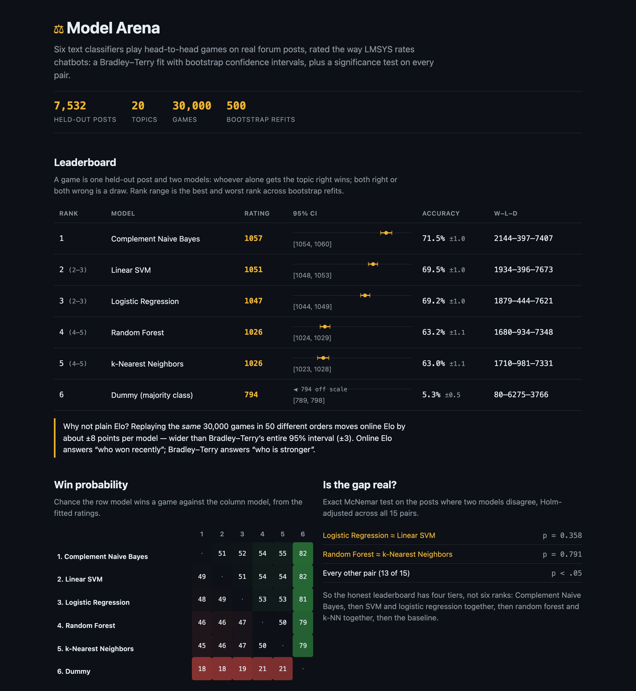
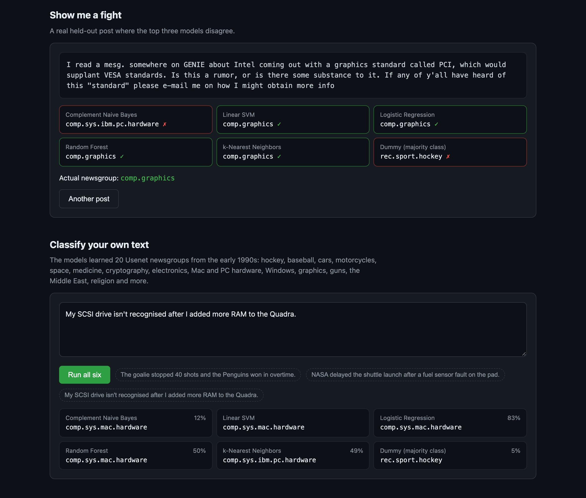

# Model Arena

[](https://github.com/otawfik/model-arena/actions/workflows/ci.yml)

Rating text classifiers the way [Chatbot Arena](https://lmarena.ai) rates chatbots. Six scikit-learn models play
30,000 head-to-head games on 7,532 real held-out forum posts. A Bradley–Terry model is fitted to every game at once,
bootstrapped for confidence intervals on both rating and rank, and checked against an exact McNemar test on every pair.



## Results

20 Newsgroups, standard by-date split (11,314 train / 7,532 test, 20 topics), with headers, signatures and quoted
replies stripped so models can't shortcut on metadata. Reproduce with `python scripts/run_arena.py`; the full output
is in [`models/leaderboard.json`](models/leaderboard.json).

| rank (bootstrap range) | model | rating | 95% CI | accuracy | W–L–D |
| --- | --- | --- | --- | --- | --- |
| 1 | Complement Naive Bayes | **1057** | [1054, 1060] | 71.5% | 2144–397–7407 |
| 2 (2–3) | Linear SVM | 1051 | [1048, 1053] | 69.5% | 1934–396–7673 |
| 3 (2–3) | Logistic Regression | 1047 | [1044, 1049] | 69.2% | 1879–444–7621 |
| 4 (4–5) | Random Forest | 1026 | [1024, 1029] | 63.2% | 1680–934–7348 |
| 5 (4–5) | k-Nearest Neighbors | 1026 | [1023, 1028] | 63.0% | 1710–981–7331 |
| 6 | Dummy (majority class) | 794 | [789, 798] | 5.3% | 80–6275–3766 |

What the numbers say:

- **Four tiers, not six ranks.** McNemar (Holm-adjusted) finds 13 of 15 gaps significant. The two that aren't,
  Linear SVM vs Logistic Regression (p = 0.36) and Random Forest vs k-NN (p = 0.79), are exactly the pairs whose
  bootstrap rank intervals overlap. Two independent methods, same answer.
- **The simplest model wins.** Complement Naive Bayes beats both linear models significantly (p < 10⁻⁵). It was
  designed for this setting ([Rennie et al., 2003](https://people.csail.mit.edu/jrennie/papers/icml03-nb.pdf)): it
  estimates each class from the *other* classes' word counts, which corrects for the skew that hurts ordinary
  Naive Bayes on many-class text.
- **Online Elo is the wrong tool here.** Replaying the *same* 30,000 games in 50 different orders moves each model's
  online Elo by about ±7 points (standard deviation), more than twice the half-width of Bradley–Terry's 95% interval.
  Random Forest finishes above k-NN in 28 of those 50 orderings, a coin flip. Bradley–Terry has no order, so it's
  the headline; online Elo is kept in the JSON for comparison.

## Method

**Games.** A game is one held-out post and two distinct models drawn uniformly at random. The model that alone
predicts the right newsgroup wins; both right or both wrong is a draw. This mirrors Chatbot Arena's design, where a
game is one prompt and two chatbots. An earlier version replayed whole-test-set comparisons between each pair; that
is deterministic, so every replay added no information and Elo just drifted with match order.

**Bradley–Terry.** Each model gets a strength *p<sub>i</sub>* with P(*i* beats *j*) = *p<sub>i</sub>* / (*p<sub>i</sub>* + *p<sub>j</sub>*),
draws counted as half a win each. Fitted by maximum likelihood with Hunter's MM algorithm, reported on the Elo
scale (400 points = 10:1 odds, mean 1000).

**Uncertainty.** 500 bootstrap refits over resampled games give the 95% rating interval and the rank range.
Accuracy intervals are Wilson score intervals.

**Significance.** For each pair, the exact McNemar test uses only the posts where exactly one model is right, which
is the right paired test when both models predict the same test set. Holm's step-down correction controls the
family-wise error rate across all 15 pairs.

## The demo



`python app.py` serves the leaderboard plus two interactive pieces:

- **Show me a fight**: a random held-out post where the top three models disagree. Guess, then reveal.
- **Classify your own text**: all six models on anything you paste, with each model's confidence (Linear SVM
  reports none, because its margins aren't probabilities).

The page itself is static JSON. `/api/classify` loads the fitted pipelines on first use, from `artifacts/` if you've
run the script, otherwise from the [v1.0 release](https://github.com/otawfik/model-arena/releases/tag/v1.0)
(43 MB, SHA-256 checked before it's loaded). Email addresses in the old Usenet signatures are scrubbed from the
demo posts.

## Run it

```bash
pip install -r requirements.txt

python scripts/run_arena.py   # download 20 Newsgroups, train, play, rate (~1 min)
python app.py                 # http://localhost:5000
pytest                        # 37 tests, offline, ~1s
```

The tests run on a small synthetic corpus, so they need no download. They check that Bradley–Terry recovers known
strengths from simulated games, that it's invariant to game order while online Elo isn't, McNemar and Holm against
hand-computed values, and the API end to end.

## Layout

```
src/
  data.py         20 Newsgroups loader + synthetic corpus for tests
  models.py       six TF-IDF pipelines behind one interface
  arena.py        per-document games from a correctness matrix
  elo.py          Elo expected score and update
  ratings.py      online Elo, order spread, Bradley–Terry (MM), bootstrap
  stats.py        exact McNemar, Holm correction, Wilson interval
  tournament.py   runs it all and assembles the leaderboard
scripts/run_arena.py
app.py, templates/index.html
models/           leaderboard.json, disagreements.json (committed results)
```

## Limits

- One dataset. Rankings on short text or a different domain could differ; the method carries over unchanged.
- Hyperparameters were set once by hand for long forum posts, not tuned per model on a validation split, so the
  margins between tiers are a fair comparison of reasonable defaults rather than each model's ceiling.

Python · scikit-learn · SciPy · NumPy · Flask · pytest
