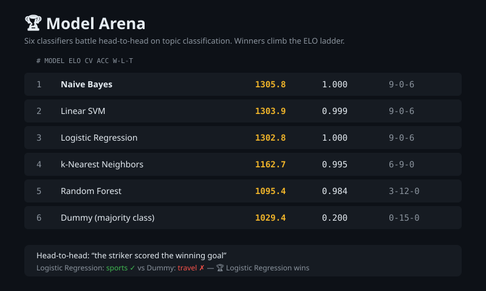

# Model Arena

Battle-test ML classifiers head-to-head: six text classifiers fight pairwise matchups on topic classification, winners climb a chess-style ELO ladder, and the Flask demo lets you run your own fights.



## Features

- **6 contenders**: Naive Bayes, Logistic Regression, Linear SVM, Random Forest, k-NN, and a Dummy majority-class baseline, all TF-IDF pipelines
- **Pairwise battles**: every model pair fights on a held-out test set; a model wins a sample only when it alone predicts the true label
- **ELO ratings**: chess-style ratings from 1200, k=32, round-robin x3 (45 battles); upsets earn more points
- **Honest dual scoreboard**: 5-fold CV accuracy/F1 alongside ELO and win-loss-tie records
- **Interactive demo**: leaderboard table, head-to-head battle form (pick two models, enter text, set the expected topic), and a JSON API at `/api/leaderboard`

## Quickstart

```bash
pip install -r requirements.txt

# run the full tournament (reproduces the table below)
python scripts/run_arena.py

# launch the demo (http://localhost:5000)
python app.py

# run the test suite
pytest
```

Or in five lines:

```python
from src import arena, data, models

texts, labels = data.generate()
x_tr, x_te, y_tr, y_te = data.train_test_split(texts, labels)
fitted = {n: models.train(n, x_tr, y_tr) for n in ["logreg", "knn"]}
print(arena.run_tournament(fitted, x_te, y_te)["ratings"])
```

## Benchmark

1000 synthetic texts (5 topics: sports, tech, food, travel, finance), 750 train / 250 test, 12% cross-topic word noise so classes overlap. ELO from 1200, k=32, 3 round-robin rounds = 45 battles. Full results in `models/leaderboard.json`.

| rank | model | ELO | CV accuracy | battle record |
| --- | --- | --- | --- | --- |
| 1 | Naive Bayes | 1305.8 | 1.000 | 9-0-6 |
| 2 | Linear SVM | 1303.9 | 0.999 | 9-0-6 |
| 3 | Logistic Regression | 1302.8 | 1.000 | 9-0-6 |
| 4 | k-Nearest Neighbors | 1162.7 | 0.995 | 6-9-0 |
| 5 | Random Forest | 1095.4 | 0.984 | 3-12-0 |
| 6 | Dummy (majority class) | 1029.4 | 0.200 | 0-15-0 |

Honest caveats: the corpus is synthetic by construction, so the headline is the *relative* ordering (linear models dominate sparse text, ensembles trail), not the absolute scores. Naive Bayes edges the linear pack because TF-IDF + NB is unusually well suited to word-count signals; the 6 ties among the top three are battles where both models were right on every sample.

## How it works

1. `src/data.py` generates a 5-topic synthetic text corpus with tunable cross-topic word noise (seeded, reproducible).
2. `src/models.py` registers six TF-IDF + classifier pipelines behind one `train`/`predict` interface.
3. `src/evaluate.py` runs stratified 5-fold CV (accuracy, macro F1, fit time) and held-out accuracy.
4. `src/elo.py` implements the ELO system: expected scores from rating gaps, zero-sum updates.
5. `src/arena.py` plays every pair head-to-head on the test set (a point goes to the model that alone gets the label right) and updates ELO after each battle.
6. `src/leaderboard.py` merges CV metrics, ELO, and win-loss-tie records into a ranked board.
7. `app.py` serves the leaderboard, the battle form, and the JSON API.

## Resume bullets

- Built a pairwise model-evaluation arena: 6 sklearn classifiers compete in 45 head-to-head battles with chess-style ELO ratings (k=32) on a 1,000-sample synthetic text corpus
- Shipped a Flask demo with a live leaderboard, interactive contender battles, and a JSON API, plus a 28-test pytest suite
- Found linear models (Naive Bayes, SVM, Logistic Regression) undefeated at ~1300 ELO while ensembles lagged, documenting the full benchmark methodology in the README
